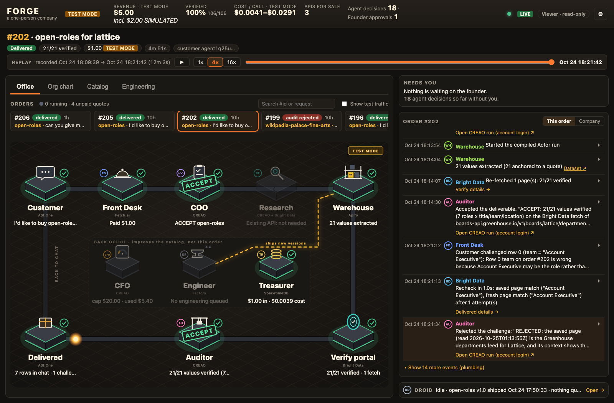
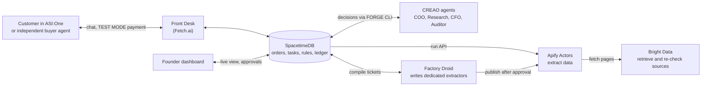

# FORGE

Ask for a public-data API in ASI:One. FORGE checks whether the request is allowed, extracts the data, and verifies each value against its source. When an API earns repeat demand, its agents can turn the generic extractor into a dedicated program that avoids LLM extraction costs.

FORGE is a one-person company staffed by AI agents, built at Cal Hacks 13.0. Customers buy reusable APIs through chat. Agents handle admission, research, fulfillment, investment, and quality checks. The founder controls budgets and approves consequential actions from a live dashboard.

[Open the dashboard](https://forge-calhacks.vercel.app) · [Find the Front Desk on Agentverse](https://agentverse.ai/agents/details/agent1qwxszhvaegkq6lsu8n0aks5sqz0l4h63janfx0xgrgcnvxgkl6n6uafetjq/profile) · [Maintenance guide](AGENTS.md)



Captured on October 25, 2026 from the current dashboard build, connected to the live database. The selected order is completed; its recorded run can be replayed from the button under the headline. All money is TEST MODE, and the header identifies simulated payments separately.

## What FORGE sells

An API is a named, re-runnable specification with input parameters, sources, an output JSON Schema, a page cap, and a freshness policy. Buyers can run the same API again without commissioning another build.

| API | Data | Engine |
| --- | --- | --- |
| `open-roles` | Public job listings with title, team, and location | Tier 1 deterministic Actor |
| `yc-directory` | Public company directory data | Tier 0 generic extraction Task |
| `gpu-listings` | Public retailer listings with price, stock, and links | Tier 0 generic extraction Task |

Tier 0 uses an Apify Task with saved inputs for the shared `forge-extract` Actor. Claude reads each saved page and returns values with verbatim excerpts. This lets FORGE serve an admitted request without writing a dedicated extractor first.

Tier 1 uses a dedicated Apify Actor compiled by Factory Droid from `actors/template`. It extracts through selectors or the source's JSON, without an LLM. The API keeps its name and output schema. Compilation is an investment decision based on demand, quality, and cost, rather than a build for every customer.

Every value carries its source URL, excerpt, snapshot key and hash, observation and verification timestamps, API version, extraction method, and status. Results arrive in chat as a short table or summary with an Apify dataset or JSON export link.

## How the agents work

Every agent talks to one shared database, SpacetimeDB. Agents never call each other directly. They read state, record decisions, and pick up tasks from the queue, while database rules decide what each role is allowed to do.



### An order, step by step

1. **Ask.** A customer requests an API in ASI:One. The Front Desk rejects personal data, blocked domains, and oversized requests before anything costs money.
2. **Admit.** For a new source, Research checks robots.txt, terms, reachability, and how often the data changes. The COO then accepts, counteroffers, or rejects with a reason.
3. **Pay.** The customer pays in TEST MODE and the order enters the task queue.
4. **Extract and verify.** An Apify Actor saves each page and extracts values with verbatim source quotes. Bright Data fetches the source again independently. A value that cannot be matched to its source is marked `unverifiable`.
5. **Audit and deliver.** The Auditor accepts or rejects the result with a written reason. The Front Desk delivers accepted results in chat; customers can send `status` at any time.

### Two other flows

- **Compile.** When an API has enough buyers or its quality drops, the CFO decides whether to fund a dedicated extractor. Factory Droid writes it under a restricted tool policy, tests run, the Auditor reviews it, and the founder approves the ship. Rejected attempts go back to the same Droid session.
- **Challenge.** A customer can dispute a delivered value. FORGE compares it with the original saved page and a fresh fetch, and the Auditor rules. An upheld challenge corrects the value, refunds the order in TEST MODE ledger credits, claws back bonuses, and opens a repair ticket. A page that changed after extraction is not counted as an extractor error.

### Who does what

| Role | Runs on | Job |
| --- | --- | --- |
| Front Desk | Fetch uAgent and ASI-1 | Talk to customers, run cheap checks, take payment, deliver, open challenges |
| Buyer | Separate Fetch uAgent | Buy an API as an ordinary customer with its own wallet |
| COO | CREAO | Accept, counteroffer, request research, or reject orders |
| Research | CREAO and Bright Data | Check whether a source may be collected and how volatile it is |
| CFO | CREAO | Decide whether a compile is worth the money |
| Auditor | CREAO | Accept or reject deliverables, challenges, and compiles |
| Treasurer and rules | SpacetimeDB reducers | Move money, enforce budgets, issue bonuses and refunds, open compile tickets |
| Engineer | Factory Droid and `droid-runner` | Write and revise dedicated extractors |
| Founder | Dashboard | Set budgets and approve spending, shipping, Droid actions, and refunds |

### Guardrails

- Only database reducers grant authority, based on the caller's role. Chat, web pages, agent output, and webhook bodies are untrusted.
- Only the dispatcher starts CREAO runs. Each agent acts through the [FORGE CLI](skills/forge-cli/SKILL.md) with its own seat token.
- Droid cannot use the network, read secrets, or deploy. Only the worker publishes, and only after Auditor acceptance and founder approval.
- The ledger is private and double-entry in integer cents. All money is TEST MODE, and refunds are FORGE ledger credits, not Stripe or FET reversals.
- Nothing is staged or invented. Playback is labeled REPLAY or RECORDED, and simulated activity is labeled SIMULATED.

The full operating rules are in [AGENTS.md](AGENTS.md).
## Dashboard

Customers use ASI:One. The [founder dashboard](https://forge-calhacks.vercel.app) follows company state through SpacetimeDB subscriptions on desktop and phone. Fresh visitors have read-only Viewer access.

| View | What it shows |
| --- | --- |
| Header and order headline | Revenue, verification, agent decisions, founder approvals, and the selected order's status, with a one-click replay of its recorded run |
| Office | The order moving through role stations, with decision reasons, source checks, and run links in drawers |
| Org chart | Each employee's responsibilities, with one line per handoff between agents, counted from stored events |
| Catalog | APIs, tier, version, buyers, sources, fields, measured costs, and datasets |
| Engineering | Compile triggers, CFO decisions, budget reservations, Droid calls and diffs, tests, Auditor reviews, approvals, and ships |
| Needs you and feed | Approval cards, readable events, raw event expanders, and current engineering status |
| Controls | Founder-only budget, compile thresholds, concurrency, refund limit, admission settings, and other stored policy levers |

The dashboard uses React, SVG, and Framer Motion. Its behavior is specified in [the dashboard contract](docs/dashboard-redesign-spec.md).

## Stack

| Layer | Technologies | Purpose |
| --- | --- | --- |
| Company backend | TypeScript, SpacetimeDB 2.13, Maincloud | Shared state, authorization, reducers, procedures, schedules, callbacks, and live subscriptions |
| Dashboard | React, Vite, TypeScript, SVG, Framer Motion, generated SpacetimeDB bindings | Live founder operations and approval controls; static frontend hosted on Vercel |
| Customer and buyer agents | Python 3.12, uv, uAgents, Agentverse, ASI:One, ASI-1 | Chat, discovery, intent parsing, and agent-to-agent purchases |
| Decisions | CREAO saved agents, API Trigger, Secrets, FORGE CLI | Admission, research, investment, and auditing |
| API execution | Node.js, Apify SDK, Actors, Tasks, datasets, key-value stores | Reusable engines, structured results, and saved source snapshots |
| Generic extraction | Anthropic Messages API and Claude Haiku tool output | Values and source excerpts for Tier 0 |
| Retrieval | Bright Data Web Unlocker, SERP API, configurable Browser API | Discovery, source retrieval, verification, and rechecks |
| Engineering | Factory Droid TypeScript SDK, Droid CLI, Git worktrees | Restricted compilation, streamed execution, and same-session repair |
| Test payments | Fetch Payment Protocol, Stripe test checkout, testnet FET | Human and autonomous purchases, all TEST MODE |
| Build and checks | pnpm workspaces, TypeScript, Node test runner, pytest, canary worker | Builds, policy tests, integration checks, and live API checks |

## Sponsors and technology integrations

### CREAO

CREAO runs the COO, Research, CFO, and Auditor as saved agents. FORGE uses API Trigger to start runs, receives completion through webhooks or polling, and stores seat credentials in CREAO Secrets. The agents use the sandbox's FORGE CLI to read company state and call role-specific reducers.

Remove the CREAO agents and FORGE stops working. Every paid order waits at `paid` until the COO decides, nothing is delivered until the Auditor accepts it, and compile tickets cannot get investment approval without the CFO.

The agents hand work to each other through the shared task queue rather than calling each other. The COO sends a new source to Research, Research reports back to the COO, the CFO funds a compile for Droid, and the Auditor sends a rejected compile back to Droid. Each line on the dashboard's org chart is one of these handoffs, counted from stored events.

| Seat | Agent ID |
| --- | --- |
| COO | [`81c6c2cc-98d6-4ea5-8fcf-942f8772bf20`](https://agent.creao.ai/apps/81c6c2cc-98d6-4ea5-8fcf-942f8772bf20) |
| Research | [`bad9531d-a359-4af3-9913-fc9310fe4218`](https://agent.creao.ai/apps/bad9531d-a359-4af3-9913-fc9310fe4218) |
| CFO | [`63d131de-1b0c-4801-a58f-1698c894a672`](https://agent.creao.ai/apps/63d131de-1b0c-4801-a58f-1698c894a672) |
| Auditor | [`6865c094-e20c-48c7-a969-d5e75c67dd06`](https://agent.creao.ai/apps/6865c094-e20c-48c7-a969-d5e75c67dd06) |

Recorded runs from real orders and the `open-roles` compile. Each run ID opens its public CREAO share page:

| Seat | What it decided | Run ID |
| --- | --- | --- |
| COO | Order #202: accepted the existing `open-roles` API | [`d808efca-0904-4c0c-bf2a-57934c77643b`](https://agent.creao.ai/share/3214dd91ef130d1744acef28b49d771c) |
| Auditor | Order #202: accepted 21/21 verified values | [`a10d1414-5b62-494e-bf29-df3e28885c76`](https://agent.creao.ai/share/ee78defeb4a58051712f21d6721d8b08) |
| Auditor | Challenge #14 on order #202: rejected, the saved page supports the value | [`3c503efd-776f-48da-b3e8-fe611bb41b22`](https://agent.creao.ai/share/799a13f02622d1236cd6a18d6ff48c24) |
| Research | Order #199: gate checks for a new Wikipedia source | [`3c53bb8a-ca6a-4858-a208-a729f940d8ad`](https://agent.creao.ai/share/56e31b7d730075775e9214107c845209) |
| COO | Order #199: decided after reading Research's findings | [`88e3561d-b521-4aad-86db-035c099c1c24`](https://agent.creao.ai/share/f2e5faea81abcb3a6d39b58c6bb454bb) |
| Auditor | Order #199: rejected a delivery missing a requested field | [`d1a138fb-f4c1-42c2-bd89-bba9c3698135`](https://agent.creao.ai/share/8f6e654c82409cb3d2a690eec9324561) |
| CFO | Compile ticket #6: funded the `open-roles` compile | [`57cb47f7-b02e-4d58-8fe1-29943d0937dc`](https://agent.creao.ai/share/2361cbf6417714be089c498e9e96c580) |
| Auditor | Compile ticket #6, attempt 1: rejected | [`4e5f8425-ec46-4d3e-9960-e967e5a40987`](https://agent.creao.ai/share/b5df27665ee55ab36e6371095f289e4f) |
| Auditor | Compile ticket #6, attempt 2: accepted | [`e0b6c53f-079d-4bf7-b419-17c7d6babdcc`](https://agent.creao.ai/share/6d5285c0ae9d6d3315e5a3f9b408da88) |

Run IDs come from the `run` table and the saved records in [`docs/proof/`](docs/proof/).

[Saved prompts and setup](docs/creao/README.md) · [Deployment notes](docs/creao/deployment.md). The CFO run's comparison includes simulated compile-test fixtures, as documented in the deployment notes. CREAO share links expire; the CFO link expires November 23, 2026.

Official references: [Cal Hacks guide](https://community.creao.ai/CalHacks2026), [technical guide](https://community.creao.ai/CalHacks2026/tech), and [saved agents](https://docs.creao.ai/features/agents).

### Factory Droid SDK

`workers/droid-runner` uses the TypeScript SDK to create or resume engineering sessions, stream messages and tool calls, and apply permission decisions. Droid writes deterministic extractors from saved-page fixtures. Its output goes through tests, Auditor review, and founder ship approval before deployment.

This makes engineering part of the running product. Demand and quality rules can create a cheaper extraction engine without the founder writing each one manually.

| Compile action | Policy |
| --- | --- |
| Read files and edit extractor source inside the Actor | Allowed within the session's tool restrictions |
| Run allowlisted fixture and contract tests | Allowed |
| Write outside the Actor or change shared runtime plumbing | Denied |
| Access secrets, use network commands, deploy, or rewrite Git history | Denied |
| Run another plain command | Requires a founder `droid_action` approval |
| Publish a version | Worker-only action after founder `api_ship` approval |

Sessions use Low autonomy and `direct_only` execution. The [policy](workers/droid-runner/src/policy.ts) and [lockdown](workers/droid-runner/src/lockdown.ts) record the restrictions; Engineering displays their outcomes.

#### How a compile works

1. **Setup.** The worker copies `actors/template` into a scratch folder outside the repo, `/tmp/forge-compile/<api>/`, with no secrets. It adds the pages saved by earlier Tier 0 runs and `expected.json`, the values the Auditor already accepted.
2. **Droid's turn.** Droid reads the saved pages and writes `src/extract.js` using selectors, markup patterns, or the source's JSON. It must not hardcode fixture values or row counts. It runs the fixture and contract tests itself and fixes failures.
3. **Live test.** After Droid's turn, the worker runs the live test against the real source. At least 80% of values must be anchored, and the row count must stay within 50% of the fixture. The worker then copies the Actor into `actors/<api>/` and records a hash of its `src/` folder.
4. **Review.** The Auditor accepts or rejects the attempt with a reason. A rejection goes back to the same Droid session and folder for rework.
5. **Ship.** After the Auditor accepts and the founder approves the ship, the worker checks that `src/` still matches the hash the Auditor accepted, then runs `apify push`. Changed code stops the ship.
6. **Switch over.** Apify builds the new Actor version, and the worker records it in SpacetimeDB. Every later buyer of that API runs the compiled Actor.

The worker never commits or pushes to Git. Shipped code reaches the repository only when the founder commits `actors/<api>/`, as with `open-roles` in `5d0ff44`.

Droid gets no network access because the pages it reads are untrusted and could carry injected instructions. Working offline also makes it reproduce the audited values from saved pages, and keeps it from fetching around robots.txt, terms, and Bright Data compliance checks. Low autonomy keeps the Droid CLI from running commands on its own judgment. Every command passes through FORGE's policy, which allows tests, denies risky commands, and sends anything else to the founder for approval.

Official reference: [Droid TypeScript SDK](https://docs.factory.com/sdk/typescript).

### SpacetimeDB

SpacetimeDB is the company's only database. The TypeScript module on Maincloud stores APIs, orders, tasks, budgets, accounting, decisions, and persistent event history. Reducers enforce identity roles, atomic claims, budgets, approvals, and state transitions. Procedures and HTTP handlers connect the stored workflow to external providers.

Generated TypeScript bindings connect the dashboard through subscriptions, so a payment, challenge, or founder decision updates every connected device. The persistent `event` table supports history and replay; it is an ordinary stored table, distinct from SpacetimeDB's transient event-table feature.

The exported backend operations are listed below for integration reference.

- **Reducers:** `audit_verdict`, `backfill_canary_orders`, `cancel_task`, `cfo_propose`, `challenge_verdict`, `claim_task`, `close_compile`, `compile_failed`, `compile_verdict`, `complete_task`, `coo_decide`, `create_api`, `create_order`, `decide_approval`, `enqueue_task`, `ensure_defaults`, `lease_sweep` (scheduled), `log_droid_event`, `open_challenge`, `record_api_version`, `record_gate_check`, `record_payment`, `refund_order`, `set_run_share_url`, `reject_at_desk`, `renew_lease`, `request_droid_action`, `research_report`, `retire_api`, `set_budget_cap`, `set_config`, `set_order_params`, `set_staff`, `submit_compile`, `update_api`.
- **Procedures:** `admission_precheck` (scheduled), `apify_poll`, `create_apify_task` (scheduled), `creao_poll`, `creao_start`, `dispatch` (scheduled), `http_smoke`, `recheck` (scheduled), `research_fetch`, `settle_run_cost` (scheduled), `start_api_run` (scheduled), `verify_probe`, `verify_values` (scheduled).
- **HTTP routes:** `POST /ping`, `POST /creao-callback`, `POST /apify-callback`. Callbacks need a one-time token, never trust the body, and re-fetch the run with FORGE's key.
- **Lifecycle:** `init`.

Official references: [SpacetimeDB at Cal Hacks](https://spacetimedb.com/blog/spacetime-at-calhacks), [reducers](https://spacetimedb.com/docs/functions/reducers/), and [event-table semantics](https://spacetimedb.com/docs/tables/event-tables/).

### Fetch.ai


The Front Desk is a Python uAgent registered on Agentverse and reachable in ASI:One through the Chat Protocol. ASI-1 parses customer intent. The Payment Protocol handles Stripe test checkout or testnet FET before the Front Desk records payment and hands the order to the company.

The buyer is a separate uAgent with its own identity, seed, and wallet. It searches Agentverse, selects FORGE, asks for a named API, and pays as an independent customer. It has no staff role or FORGE service keys. Fetch supplies both the customer interface and the agent-to-agent market for reusable APIs.

| Agent | Name | Address |
| --- | --- | --- |
| Front Desk | `forge-front-desk` | `agent1qwxszhvaegkq6lsu8n0aks5sqz0l4h63janfx0xgrgcnvxgkl6n6uafetjq` |
| Buyer | `forge-buyer` | `agent1q2jj8g77x9dgyp0va9vxtzjeeajth02rv3pqhm9taf3gg6qd7uwcw4h4tr0` |

[Front Desk profile](https://agentverse.ai/agents/details/agent1qwxszhvaegkq6lsu8n0aks5sqz0l4h63janfx0xgrgcnvxgkl6n6uafetjq/profile) · [Front Desk documentation](fetch-agents/front_desk/README.md)

Official references: [Cal Hacks hackpack](https://www.fetch.ai/events/hackathons/calhacks-13-0/hackpack), [ASI:One](https://asi1.ai/), and [ASI-compatible uAgents](https://innovationlab.fetch.ai/resources/docs/examples/chat-protocol/asi-compatible-uagents).

### Apify

Apify hosts the reusable extraction engines. `forge-extract` is the generic Actor, and each Tier 0 API is a Task with its own saved configuration. Dedicated Tier 1 Actors have their own versions. Runs return structured datasets, while key-value stores retain source pages and hashes for verification and challenges.

The SDK, Tasks API, Actor run API, callbacks, and CLI let FORGE create an API, execute it repeatedly, read results, and ship approved versions. Shared Tasks avoid a new build for each request; datasets and saved pages make delivery and later checks possible.

| API | Engine | Apify ID |
| --- | --- | --- |
| `yc-directory` | Tier 0 Task | `OQN55sQeSFrmf3FW0` |
| `gpu-listings` | Tier 0 Task | `Q7CSHONOKeWjvo3kz` |
| `open-roles` | Original Tier 0 Task | `kwMQrSsk3Of8CDvhk` |
| `open-roles` | Tier 1 Actor, v1.0 | [`RdQhIe6Jj6mE2qT4L`](https://console.apify.com/actors/RdQhIe6Jj6mE2qT4L) |

Official references: [Actors](https://docs.apify.com/platform/actors) and [Actor Tasks](https://docs.apify.com/platform/actors/running/tasks).

### Bright Data

Bright Data retrieves the public pages used for extraction and independently re-fetches them for verification. The second fetch lets FORGE check an extractor's output against the source rather than accepting the extractor's own claim.

| Product | FORGE use |
| --- | --- |
| Web Unlocker, `forge_unlocker` | Actor retrieval, admission reachability and volatility checks, independent verification, and challenge rechecks |
| SERP API, `forge_serp` | Research discovery through `forge search` |
| Browser API | Configurable fallback for JavaScript-rendered pages; requires `BRIGHTDATA_BROWSER_WSS` and remains an unexercised live integration |

The retrieval ladder starts with Web Unlocker in the US. A JavaScript shell can use Browser API when configured. A block or timeout can retry once from another country; exhausted attempts become `unverifiable`. Compliance blocks stop immediately without browser or country retries. Each attempt records its status, timing, country, and reason.

Official references: [Web Unlocker](https://docs.brightdata.com/products/web-unlocker/introduction), [SERP API](https://docs.brightdata.com/products/serp-api/introduction), and [Browser API](https://docs.brightdata.com/products/scraping-browser/introduction).

### Microsoft: Built for the Real World

FORGE targets Microsoft's Built for the Real World track with an agent company for developers who need reusable public-data APIs. It handles the complete customer journey in ASI:One: request, admission, test payment, verified delivery, and a challenge when a value looks wrong.

The product puts responsible operation into the workflow. Source quotes and saved snapshots make results inspectable. Identity-based roles, budget limits, founder approvals, and TEST MODE accounting constrain what agents can do. Reusable APIs and deterministic compilation provide a path to lower operating costs as demand grows.

The track fit is the working customer workflow and its controls. The [post-hackathon plan](docs/after-hackathon.md) identifies remaining production work, including measured pricing, broader live integration checks, and full agent canaries in CI.

Official references: [Microsoft track listing](https://cal-hacks-13-0.devpost.com/) and [Cal Hacks hacker guide with track criteria](https://docs.google.com/document/d/1RQrueC9wm5u8uxtWSC2gadIchp05hVayhGUrIjxT9dE/edit?tab=t.0).

## Run it locally

Requirements: Node 22 or later with pnpm 11, Python 3.12 with uv, the `spacetime` CLI, and the `droid` CLI on the host that runs `droid-runner`.

Copy [`.env.example`](.env.example) to `.env` and fill in test keys made for this project. Never commit `.env`.

| Configuration | Variables |
| --- | --- |
| Database and worker identities | `SPACETIME_HOST`, `SPACETIME_DB`, `SPACETIME_TOKEN_FRONT_DESK`, `SPACETIME_TOKEN_DROID_RUNNER`, `SPACETIME_TOKEN_CANARY` |
| Retrieval | `BRIGHTDATA_API_KEY`, `BRIGHTDATA_UNLOCKER_ZONE`, `BRIGHTDATA_SERP_ZONE`, `BRIGHTDATA_BROWSER_WSS` |
| Actor execution | `APIFY_TOKEN`, `APIFY_USERNAME` |
| CREAO seats | `CREAO_API_KEY`, `CREAO_APP_ID_COO`, `CREAO_APP_ID_RESEARCH`, `CREAO_APP_ID_CFO`, `CREAO_APP_ID_AUDITOR` |
| Engineering | `FACTORY_API_KEY` |
| Models | `ASI1_API_KEY`, `ASI1_MODEL`, `ANTHROPIC_API_KEY`, `ANTHROPIC_MODEL` |
| Fetch identities and discovery | `FRONT_DESK_SEED`, `BUYER_AGENT_SEED`, `AGENTVERSE_API_KEY` |
| Test payments | `FORGE_DEMO_PAY`, `STRIPE_SECRET_KEY`, `STRIPE_PUBLISHABLE_KEY` |

```sh
pnpm install
pnpm run build        # every workspace package
pnpm run typecheck
pnpm test             # actor lib sync check, then every package's tests

# SpacetimeDB module
pnpm -C module run build
pnpm -C module run publish:local   # local test database forge-test (wipes its data)
pnpm -C module run test:api        # tests against a running server
pnpm -C web run generate           # regenerate client bindings

# Founder dashboard
pnpm -C web dev

# Workers
pnpm -C workers/canary run seed
pnpm -C workers/canary run canary
pnpm -C workers/droid-runner run runner

# Fetch agents (from fetch-agents/)
cd fetch-agents
uv sync
uv run pytest
uv run --env-file ../.env python -m front_desk.agent
uv run --env-file ../.env python -m buyer.agent "I'd like to buy open-roles for the Lattice Greenhouse board: job title, team and location"
```

Module env values are declared in the schema and supplied at publish time (`KEY=… spacetime publish`). A reset with `--delete-data=always` wipes them. `FORGE_DEMO_PAY=true` turns on the labeled SIMULATED PAYMENT shortcut; `.env.example` leaves it off ([docs/demo.md](docs/demo.md)).

Backend changes require direct checks against real reducers, routes, Actors, or agent APIs. Unit tests cover pure logic but do not replace those integration checks. Frontend changes require a real browser interaction and screenshot. Tier 1 versions require fixture, contract, and live-page tests. Run catalog canaries before and after merges, and commit each major feature only after its checks pass.

## Failure recovery

The dispatcher checks old CREAO runs for missed webhooks. An undecided task gets one additional run; a second undecided run fails it and refunds eligible paid orders. Runs time out after 15 minutes. Start failures retry at least 30 seconds apart and stop after five minutes. Customer-order tasks take priority over compile reviews.

Founder rescue refuses work still in flight. A refund for a delivered order must follow the challenge path. If a challenge refund was declined, the founder can request it again without changing the ruling. All refunds remain TEST MODE ledger credits.

Use the [recovery runbook](docs/demo.md#recover-a-stalled-order) for operational steps. Before a production publish, confirm that no work is in flight, build and test, publish without deleting data, and verify that orders and accounting are preserved.

## Repository layout

| Path | Contents |
| --- | --- |
| `module/` | SpacetimeDB tables, reducers, procedures, schedules, and routes |
| `web/` | Founder dashboard and generated database bindings |
| `workers/droid-runner/` | Task claims, restricted Droid sessions, tests, and approved ships |
| `workers/canary/` | Catalog seeding and end-to-end API checks |
| `fetch-agents/front_desk/` | Customer-facing uAgent |
| `fetch-agents/buyer/` | Independent buyer uAgent |
| `actors/forge-extract/` | Tier 0 generic Actor |
| `actors/template/` | Shared Tier 1 runtime and empty extractor template |
| `actors/open-roles/` | Shipped deterministic extractor |
| `actors/gpu-listings/` | Earlier compile output; catalog sales still use Tier 0 |
| `skills/forge-cli/` | Dependency-free CLI and CREAO skill instructions |
| `docs/` | Product references, agent prompts, specifications, operations, and historical records |

[AGENTS.md](AGENTS.md) defines the maintenance rules. New ideas belong in [after-hackathon.md](docs/after-hackathon.md). Sponsor references are linked in each integration section above. Event track criteria are in the [Cal Hacks hacker guide](https://docs.google.com/document/d/1RQrueC9wm5u8uxtWSC2gadIchp05hVayhGUrIjxT9dE/edit?tab=t.0).
