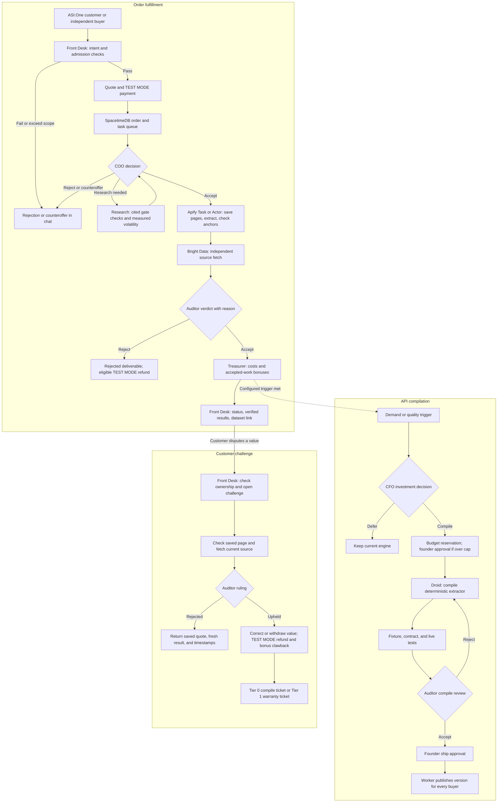

# FORGE

Ask for a public-data API in ASI:One. FORGE checks whether the request is allowed, extracts the data, and verifies each value against its source. When an API earns repeat demand, its agents can turn the generic extractor into a dedicated program that avoids LLM extraction costs.

FORGE is a one-person company staffed by AI agents, built at Cal Hacks 13.0. Customers buy reusable APIs through chat. Agents handle admission, research, fulfillment, investment, and quality checks. The founder controls budgets and approves consequential actions from a live dashboard.

[Open the dashboard](https://forge-calhacks.vercel.app) · [Find the Front Desk on Agentverse](https://agentverse.ai/agents/details/agent1qwxszhvaegkq6lsu8n0aks5sqz0l4h63janfx0xgrgcnvxgkl6n6uafetjq/profile) · [Maintenance guide](AGENTS.md)


Captured from the deployed dashboard on October 25, 2026. The selected order is a completed run with its history labeled REPLAY; the dashboard connection is LIVE. All money is TEST MODE, and the header identifies simulated payments separately.

## What FORGE sells

An API is a named, re-runnable specification with input parameters, sources, an output JSON Schema, a page cap, and a freshness policy. Buyers can run the same API again without commissioning another build.

| API | Data | Engine |
| --- | --- | --- |
| `open-roles` | Public job listings with title, team, and location | Tier 1 deterministic Actor |
| `yc-directory` | Public company directory data | Tier 0 generic extraction Task |
| `gpu-listings` | Public retailer listings with price, stock, and links | Tier 0 generic extraction Task |

Tier 0 uses an Apify Task with saved inputs for the shared `forge-extract` Actor. Claude reads each saved page and returns values with verbatim excerpts. This lets FORGE serve an admitted request without writing a dedicated extractor first.

Tier 1 uses a dedicated Apify Actor compiled by Factory Droid from `actors/template`. It extracts through selectors or the source's JSON, without an LLM. The API keeps its name and output schema. Compilation is an investment decision based on demand, quality, and cost, rather than a build for every customer.

Every value carries its source URL, excerpt, snapshot key and hash, observation and verification timestamps, API version, extraction method, and status. Results arrive in chat as a short table or summary with an Apify dataset or JSON export link.

## How the agents work



### Responsibilities and authority

| Role | Runtime | Responsibility |
| --- | --- | --- |
| Front Desk | Fetch uAgent and ASI-1 | Parse requests, run deterministic checks, quote, take test payment, report status, deliver results, and open challenges |
| Buyer | Separate Fetch uAgent | Discover FORGE on Agentverse and purchase an API with its own identity and testnet wallet |
| COO | CREAO saved agent | Accept, counteroffer, request research, or reject with a reason |
| Research | CREAO saved agent and Bright Data | Record admission findings, citations, reachability, and measured volatility |
| CFO | CREAO saved agent | Propose compilation, defer investment, or recommend repricing using unit economics |
| Auditor | CREAO saved agent | Accept or reject deliverables, challenges, and compile attempts using recorded checks |
| Treasurer and rules | SpacetimeDB reducers | Enforce money movements, budgets, bonuses, refunds, and compile triggers |
| Engineer | Factory Droid SDK and `droid-runner` | Compile deterministic extractors and revise rejected attempts in the same engineering session |
| Founder | Dashboard under the founder identity | Set controls and approve gated spending, shipping, Droid actions, and refunds |

CREAO agents use the dependency-free [FORGE CLI](skills/forge-cli/SKILL.md) with separate seat tokens. Only the dispatcher starts CREAO runs. Agents cannot start other agents or grant themselves authority. Each CREAO dispatch starts a new thread; Droid resumes its engineering session for rework on the same API.

### Admission before fulfillment

Checks run in cost order. Deterministic Front Desk checks precede paid research or extraction.

| Check | Rule | Outcome on failure |
| --- | --- | --- |
| Requested fields | Public data only. Reject personal names, emails, phone numbers, and profiles. Aggregate counts are allowed. | Immediate rejection with a reason |
| Source domain | Reject domains on `config.blocked_domains`, including login-only sources | Immediate rejection |
| Scope | Stay within `config.page_cap` | Counteroffer for a bounded number of pages |
| robots.txt | Check whether the requested paths allow collection | Record a gate finding for the COO |
| Terms | Cite the automated-collection clause and its URL | Reject prohibited or unclear terms |
| Reachability | Data must be accessible by URL or search, without a login, paywall, or multi-step form | Reject unsupported sources |
| Volatility | Compare two fetches at least 120 seconds apart | Set the freshness policy from the observed result |

An existing admitted API can proceed to fulfillment. For a new request, the COO requests Research, reads the stored findings, and decides whether to create a Tier 0 API, counteroffer, or reject. Research supplies findings; the COO makes the commercial decision.

### Verification and delivery

1. The Actor saves the source page and its hash. The excerpt must occur verbatim in that page text, and the value must occur verbatim in the excerpt. A failed anchor becomes `unverifiable`.
2. A separate Bright Data fetch checks the source independently. Stable APIs require an exact excerpt and value match. Volatile APIs also enforce their freshness window; a changed anchored value becomes `stale` with the fresh value attached.
3. Every retrieval attempt records its method, country, HTTP status, duration, and result. Exhausted retrieval becomes `unverifiable`, never an invented replacement.
4. The Auditor reads the deterministic results and records acceptance or rejection with a reason. Unverified output is not delivered as fact. Bonuses depend on accepted work.
5. The Front Desk reads the stored order and returns results in chat. Customers send `status` to retrieve progress and delivery because ASI:One may not display delayed agent-initiated messages.

### Compilation and version rules

Reducers open a compile ticket when verified quality falls below the configured threshold over the configured run window, an upheld Tier 0 challenge identifies an extractor error, or distinct buyers reach the demand threshold. The CFO can defer a demand-triggered investment.

A funded compile follows these rules:

- The engineering reservation must fit the budget cap or wait for founder approval. Lowering the cap re-evaluates pending compiles and makes those that no longer fit ineligible.
- The worker creates an Actor worktree without secrets and supplies saved Tier 0 pages with audited expected values.
- Droid edits the extractor under a restricted tool policy. Shared fetching, anchoring, and runtime plumbing stay read-only.
- Fixture tests, additive-schema contract tests, and live-page tests must pass. The worker runs network-dependent live tests outside Droid's restricted turn.
- An Auditor rejection returns the reason to the same Droid session. Test success, Auditor acceptance, founder ship approval, and deployment are separate steps.
- Only the worker publishes after founder approval. Versions are additive: fields cannot be removed or renamed, and compilation preserves the API schema.

### Challenges and accountability

A customer names the order, row, metric, and reason. The Front Desk checks ownership and opens a challenge on a delivered value. FORGE compares the original saved page with the extractor's output and fetches the current source separately.

The recheck targets seconds; the CREAO Auditor's ruling can take minutes. A page changing after extraction does not establish an extractor error.

If the saved page shows that extraction was wrong, the Auditor upholds the challenge. A new value record supersedes the old one with an anchored correction, or withdraws it as `unverifiable` when no correction is supported. The Treasurer credits the eligible refund and claws back the associated bonuses. The rules open a Tier 0 compile ticket or a Tier 1 warranty ticket. A rejected challenge returns the saved quote, fresh result, and timestamps without a penalty.

### Rules that apply to every agent

- Only authenticated reducers authorize actions using `ctx.sender` roles and stored state. Chat, pages, agent output, and webhook bodies are untrusted inputs.
- Founder approvals happen through dashboard reducer calls under the founder identity.
- Reducers enforce state transitions and write events. Procedures and workers perform external calls, with no transaction open during HTTP requests.
- Workers claim tasks atomically, hold expiring leases, and can complete only tasks they own. Expired leases return work to the queue.
- Callbacks require one-time tokens. FORGE re-fetches provider status using server-side credentials and deduplicates run IDs.
- The ledger is private and double-entry. Money uses integer cents, and each transaction balances to zero. The dashboard reads public summaries.
- Keys stay server-side. Actor worktrees contain no secrets. Never commit credentials.
- No staged failures or fabricated results. Historical playback is labeled REPLAY or RECORDED; simulated activity is labeled SIMULATED.
- All payments, revenue, budgets, bonuses, and refunds are TEST MODE. Refunds credit FORGE's ledger; they do not reverse Stripe test payments or testnet FET transfers.

## Dashboard

Customers use ASI:One. The [founder dashboard](https://forge-calhacks.vercel.app) follows company state through SpacetimeDB subscriptions on desktop and phone. Fresh visitors have read-only Viewer access.

| View | What it shows |
| --- | --- |
| Header and order headline | Revenue, verification, cost per call, catalog size, agent decisions, founder approvals, and the selected order's status |
| Office | The order moving through role stations, with decision reasons, source checks, and run links in drawers |
| Org chart | Employee responsibilities and handoffs counted from stored events |
| Catalog | APIs, tier, version, buyers, sources, fields, measured costs, and datasets |
| Engineering | Compile triggers, CFO decisions, budget reservations, Droid calls and diffs, tests, Auditor reviews, approvals, and ships |
| Needs you and feed | Approval cards, readable events, raw event expanders, and current engineering status |
| Controls | Founder-only budget, compile thresholds, concurrency, refund limit, admission settings, and other stored policy levers |

The dashboard uses React, SVG, and Framer Motion. Its behavior is specified in [the dashboard contract](docs/dashboard-redesign-spec.md).

## Stack

| Layer | Technologies | Purpose |
| --- | --- | --- |
| Company backend | TypeScript, SpacetimeDB 2.13, Maincloud | Shared state, authorization, reducers, procedures, schedules, callbacks, and live subscriptions |
| Dashboard | React, Vite, TypeScript, SVG, Framer Motion, generated SpacetimeDB bindings | Live founder operations and approval controls; static frontend hosted on Vercel |
| Customer and buyer agents | Python 3.12, uv, uAgents, Agentverse, ASI:One, ASI-1 | Chat, discovery, intent parsing, and agent-to-agent purchases |
| Decisions | CREAO saved agents, API Trigger, Secrets, FORGE CLI | Admission, research, investment, and auditing |
| API execution | Node.js, Apify SDK, Actors, Tasks, datasets, key-value stores | Reusable engines, structured results, and saved source snapshots |
| Generic extraction | Anthropic Messages API and Claude Haiku tool output | Values and source excerpts for Tier 0 |
| Retrieval | Bright Data Web Unlocker, SERP API, configurable Browser API | Discovery, source retrieval, verification, and rechecks |
| Engineering | Factory Droid TypeScript SDK, Droid CLI, Git worktrees | Restricted compilation, streamed execution, and same-session repair |
| Test payments | Fetch Payment Protocol, Stripe test checkout, testnet FET | Human and autonomous purchases, all TEST MODE |
| Build and checks | pnpm workspaces, TypeScript, Node test runner, pytest, canary worker | Builds, policy tests, integration checks, and live API checks |

## Sponsors and technology integrations

### CREAO

CREAO runs the COO, Research, CFO, and Auditor as saved agents. FORGE uses API Trigger to start runs, receives completion through webhooks or polling, and stores seat credentials in CREAO Secrets. The agents use the sandbox's FORGE CLI to read company state and call role-specific reducers.

This gives the company explicit decision makers with written reasons and inspectable runs. Without those decisions, paid orders cannot move through admission and audit, and compile tickets cannot receive investment approval.

| Seat | Agent ID |
| --- | --- |
| COO | [`81c6c2cc-98d6-4ea5-8fcf-942f8772bf20`](https://agent.creao.ai/apps/81c6c2cc-98d6-4ea5-8fcf-942f8772bf20) |
| Research | [`bad9531d-a359-4af3-9913-fc9310fe4218`](https://agent.creao.ai/apps/bad9531d-a359-4af3-9913-fc9310fe4218) |
| CFO | [`63d131de-1b0c-4801-a58f-1698c894a672`](https://agent.creao.ai/apps/63d131de-1b0c-4801-a58f-1698c894a672) |
| Auditor | [`6865c094-e20c-48c7-a969-d5e75c67dd06`](https://agent.creao.ai/apps/6865c094-e20c-48c7-a969-d5e75c67dd06) |

[Saved prompts and setup](docs/creao/README.md) · [Deployment notes](docs/creao/deployment.md) · [Public CFO run](https://agent.creao.ai/share/2361cbf6417714be089c498e9e96c580), available until November 23, 2026. The run's comparison includes simulated compile-test fixtures, as documented in the deployment notes.

Official references: [Cal Hacks guide](https://community.creao.ai/CalHacks2026), [technical guide](https://community.creao.ai/CalHacks2026/tech), and [saved agents](https://docs.creao.ai/features/agents).

### Factory Droid SDK

`workers/droid-runner` uses the TypeScript SDK to create or resume engineering sessions, stream messages and tool calls, and apply permission decisions. Droid writes deterministic extractors from saved-page fixtures. Its output goes through tests, Auditor review, and founder ship approval before deployment.

This makes engineering part of the running product. Demand and quality rules can create a cheaper extraction engine without the founder writing each one manually.

| Compile action | Policy |
| --- | --- |
| Read files and edit extractor source inside the Actor | Allowed within the session's tool restrictions |
| Run allowlisted fixture and contract tests | Allowed |
| Write outside the Actor or change shared runtime plumbing | Denied |
| Access secrets, use network commands, deploy, or rewrite Git history | Denied |
| Run another plain command | Requires a founder `droid_action` approval |
| Publish a version | Worker-only action after founder `api_ship` approval |

Sessions use Low autonomy and `direct_only` execution. The [policy](workers/droid-runner/src/policy.ts) and [lockdown](workers/droid-runner/src/lockdown.ts) record the restrictions; Engineering displays their outcomes.

Official reference: [Droid TypeScript SDK](https://docs.factory.com/sdk/typescript).

### SpacetimeDB

SpacetimeDB is the company's only database. The TypeScript module on Maincloud stores APIs, orders, tasks, budgets, accounting, decisions, and persistent event history. Reducers enforce identity roles, atomic claims, budgets, approvals, and state transitions. Procedures and HTTP handlers connect the stored workflow to external providers.

Generated TypeScript bindings connect the dashboard through subscriptions, so a payment, challenge, or founder decision updates every connected device. The persistent `event` table supports history and replay; it is an ordinary stored table, distinct from SpacetimeDB's transient event-table feature.

The exported backend operations are listed below for integration reference.

- **Reducers:** `audit_verdict`, `backfill_canary_orders`, `cancel_task`, `cfo_propose`, `challenge_verdict`, `claim_task`, `close_compile`, `compile_failed`, `compile_verdict`, `complete_task`, `coo_decide`, `create_api`, `create_order`, `decide_approval`, `enqueue_task`, `ensure_defaults`, `lease_sweep` (scheduled), `log_droid_event`, `open_challenge`, `record_api_version`, `record_gate_check`, `record_payment`, `refund_order`, `set_run_share_url`, `reject_at_desk`, `renew_lease`, `request_droid_action`, `research_report`, `retire_api`, `set_budget_cap`, `set_config`, `set_order_params`, `set_staff`, `submit_compile`, `update_api`.
- **Procedures:** `admission_precheck` (scheduled), `apify_poll`, `create_apify_task` (scheduled), `creao_poll`, `creao_start`, `dispatch` (scheduled), `http_smoke`, `recheck` (scheduled), `research_fetch`, `settle_run_cost` (scheduled), `start_api_run` (scheduled), `verify_probe`, `verify_values` (scheduled).
- **HTTP routes:** `POST /ping`, `POST /creao-callback`, `POST /apify-callback`. Callbacks need a one-time token, never trust the body, and re-fetch the run with FORGE's key.
- **Lifecycle:** `init`.

Official references: [SpacetimeDB at Cal Hacks](https://spacetimedb.com/blog/spacetime-at-calhacks), [reducers](https://spacetimedb.com/docs/functions/reducers/), and [event-table semantics](https://spacetimedb.com/docs/tables/event-tables/).

### Fetch.ai


The Front Desk is a Python uAgent registered on Agentverse and reachable in ASI:One through the Chat Protocol. ASI-1 parses customer intent. The Payment Protocol handles Stripe test checkout or testnet FET before the Front Desk records payment and hands the order to the company.

The buyer is a separate uAgent with its own identity, seed, and wallet. It searches Agentverse, selects FORGE, asks for a named API, and pays as an independent customer. It has no staff role or FORGE service keys. Fetch supplies both the customer interface and the agent-to-agent market for reusable APIs.

| Agent | Name | Address |
| --- | --- | --- |
| Front Desk | `forge-front-desk` | `agent1qwxszhvaegkq6lsu8n0aks5sqz0l4h63janfx0xgrgcnvxgkl6n6uafetjq` |
| Buyer | `forge-buyer` | `agent1q2jj8g77x9dgyp0va9vxtzjeeajth02rv3pqhm9taf3gg6qd7uwcw4h4tr0` |

[Front Desk profile](https://agentverse.ai/agents/details/agent1qwxszhvaegkq6lsu8n0aks5sqz0l4h63janfx0xgrgcnvxgkl6n6uafetjq/profile) · [Front Desk documentation](fetch-agents/front_desk/README.md)

Official references: [Cal Hacks hackpack](https://www.fetch.ai/events/hackathons/calhacks-13-0/hackpack), [ASI:One](https://asi1.ai/), and [ASI-compatible uAgents](https://innovationlab.fetch.ai/resources/docs/examples/chat-protocol/asi-compatible-uagents).

### Apify

Apify hosts the reusable extraction engines. `forge-extract` is the generic Actor, and each Tier 0 API is a Task with its own saved configuration. Dedicated Tier 1 Actors have their own versions. Runs return structured datasets, while key-value stores retain source pages and hashes for verification and challenges.

The SDK, Tasks API, Actor run API, callbacks, and CLI let FORGE create an API, execute it repeatedly, read results, and ship approved versions. Shared Tasks avoid a new build for each request; datasets and saved pages make delivery and later checks possible.

| API | Engine | Apify ID |
| --- | --- | --- |
| `yc-directory` | Tier 0 Task | `OQN55sQeSFrmf3FW0` |
| `gpu-listings` | Tier 0 Task | `Q7CSHONOKeWjvo3kz` |
| `open-roles` | Original Tier 0 Task | `kwMQrSsk3Of8CDvhk` |
| `open-roles` | Tier 1 Actor, v1.0 | [`RdQhIe6Jj6mE2qT4L`](https://console.apify.com/actors/RdQhIe6Jj6mE2qT4L) |

Official references: [Actors](https://docs.apify.com/platform/actors) and [Actor Tasks](https://docs.apify.com/platform/actors/running/tasks).

### Bright Data

Bright Data retrieves the public pages used for extraction and independently re-fetches them for verification. The second fetch lets FORGE check an extractor's output against the source rather than accepting the extractor's own claim.

| Product | FORGE use |
| --- | --- |
| Web Unlocker, `forge_unlocker` | Actor retrieval, admission reachability and volatility checks, independent verification, and challenge rechecks |
| SERP API, `forge_serp` | Research discovery through `forge search` |
| Browser API | Configurable fallback for JavaScript-rendered pages; requires `BRIGHTDATA_BROWSER_WSS` and remains an unexercised live integration |

The retrieval ladder starts with Web Unlocker in the US. A JavaScript shell can use Browser API when configured. A block or timeout can retry once from another country; exhausted attempts become `unverifiable`. Compliance blocks stop immediately without browser or country retries. Each attempt records its status, timing, country, and reason.

Official references: [Web Unlocker](https://docs.brightdata.com/products/web-unlocker/introduction), [SERP API](https://docs.brightdata.com/products/serp-api/introduction), and [Browser API](https://docs.brightdata.com/products/scraping-browser/introduction).

### Microsoft: Built for the Real World

FORGE targets Microsoft's Built for the Real World track with an agent company for developers who need reusable public-data APIs. It handles the complete customer journey in ASI:One: request, admission, test payment, verified delivery, and a challenge when a value looks wrong.

The product puts responsible operation into the workflow. Source quotes and saved snapshots make results inspectable. Identity-based roles, budget limits, founder approvals, and TEST MODE accounting constrain what agents can do. Reusable APIs and deterministic compilation provide a path to lower operating costs as demand grows.

The track fit is the working customer workflow and its controls. The [post-hackathon plan](docs/after-hackathon.md) identifies remaining production work, including measured pricing, broader live integration checks, and full agent canaries in CI.

Official references: [Microsoft track listing](https://cal-hacks-13-0.devpost.com/) and [Cal Hacks hacker guide with track criteria](https://docs.google.com/document/d/1RQrueC9wm5u8uxtWSC2gadIchp05hVayhGUrIjxT9dE/edit?tab=t.0).

## Run it locally

Requirements: Node 22 or later with pnpm 11, Python 3.12 with uv, the `spacetime` CLI, and the `droid` CLI on the host that runs `droid-runner`.

Copy [`.env.example`](.env.example) to `.env` and fill in test keys made for this project. Never commit `.env`.

| Configuration | Variables |
| --- | --- |
| Database and worker identities | `SPACETIME_HOST`, `SPACETIME_DB`, `SPACETIME_TOKEN_FRONT_DESK`, `SPACETIME_TOKEN_DROID_RUNNER`, `SPACETIME_TOKEN_CANARY` |
| Retrieval | `BRIGHTDATA_API_KEY`, `BRIGHTDATA_UNLOCKER_ZONE`, `BRIGHTDATA_SERP_ZONE`, `BRIGHTDATA_BROWSER_WSS` |
| Actor execution | `APIFY_TOKEN`, `APIFY_USERNAME` |
| CREAO seats | `CREAO_API_KEY`, `CREAO_APP_ID_COO`, `CREAO_APP_ID_RESEARCH`, `CREAO_APP_ID_CFO`, `CREAO_APP_ID_AUDITOR` |
| Engineering | `FACTORY_API_KEY` |
| Models | `ASI1_API_KEY`, `ASI1_MODEL`, `ANTHROPIC_API_KEY`, `ANTHROPIC_MODEL` |
| Fetch identities and discovery | `FRONT_DESK_SEED`, `BUYER_AGENT_SEED`, `AGENTVERSE_API_KEY` |
| Test payments | `FORGE_DEMO_PAY`, `STRIPE_SECRET_KEY`, `STRIPE_PUBLISHABLE_KEY` |

```sh
pnpm install
pnpm run build        # every workspace package
pnpm run typecheck
pnpm test             # actor lib sync check, then every package's tests

# SpacetimeDB module
pnpm -C module run build
pnpm -C module run publish:local   # local test database forge-test (wipes its data)
pnpm -C module run test:api        # tests against a running server
pnpm -C web run generate           # regenerate client bindings

# Founder dashboard
pnpm -C web dev

# Workers
pnpm -C workers/canary run seed
pnpm -C workers/canary run canary
pnpm -C workers/droid-runner run runner

# Fetch agents (from fetch-agents/)
cd fetch-agents
uv sync
uv run pytest
uv run --env-file ../.env python -m front_desk.agent
uv run --env-file ../.env python -m buyer.agent "I'd like to buy open-roles for the Lattice Greenhouse board: job title, team and location"
```

Module env values are declared in the schema and supplied at publish time (`KEY=… spacetime publish`). A reset with `--delete-data=always` wipes them. `FORGE_DEMO_PAY=true` turns on the labeled SIMULATED PAYMENT shortcut; `.env.example` leaves it off ([docs/demo.md](docs/demo.md)).

Backend changes require direct checks against real reducers, routes, Actors, or agent APIs. Unit tests cover pure logic but do not replace those integration checks. Frontend changes require a real browser interaction and screenshot. Tier 1 versions require fixture, contract, and live-page tests. Run catalog canaries before and after merges, and commit each major feature only after its checks pass.

## Failure recovery

The dispatcher checks old CREAO runs for missed webhooks. An undecided task gets one additional run; a second undecided run fails it and refunds eligible paid orders. Runs time out after 15 minutes. Start failures retry at least 30 seconds apart and stop after five minutes. Customer-order tasks take priority over compile reviews.

Founder rescue refuses work still in flight. A refund for a delivered order must follow the challenge path. If a challenge refund was declined, the founder can request it again without changing the ruling. All refunds remain TEST MODE ledger credits.

Use the [recovery runbook](docs/demo.md#recover-a-stalled-order) for operational steps. Before a production publish, confirm that no work is in flight, build and test, publish without deleting data, and verify that orders and accounting are preserved.

## Repository layout

| Path | Contents |
| --- | --- |
| `module/` | SpacetimeDB tables, reducers, procedures, schedules, and routes |
| `web/` | Founder dashboard and generated database bindings |
| `workers/droid-runner/` | Task claims, restricted Droid sessions, tests, and approved ships |
| `workers/canary/` | Catalog seeding and end-to-end API checks |
| `fetch-agents/front_desk/` | Customer-facing uAgent |
| `fetch-agents/buyer/` | Independent buyer uAgent |
| `actors/forge-extract/` | Tier 0 generic Actor |
| `actors/template/` | Shared Tier 1 runtime and empty extractor template |
| `actors/open-roles/` | Shipped deterministic extractor |
| `actors/gpu-listings/` | Earlier compile output; catalog sales still use Tier 0 |
| `skills/forge-cli/` | Dependency-free CLI and CREAO skill instructions |
| `docs/` | Product references, agent prompts, specifications, operations, and historical records |

[AGENTS.md](AGENTS.md) defines the maintenance rules. New ideas belong in [after-hackathon.md](docs/after-hackathon.md). Sponsor references are linked in each integration section above. Event track criteria are in the [Cal Hacks hacker guide](https://docs.google.com/document/d/1RQrueC9wm5u8uxtWSC2gadIchp05hVayhGUrIjxT9dE/edit?tab=t.0).
